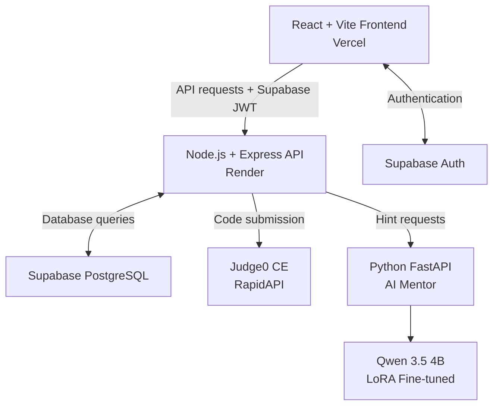

# 🧠 CodeMentor

\<div align="center">

**Learn to code by thinking, not copy-pasting.**

An AI-guided coding education platform that helps students develop real problem-solving skills through interactive lessons, progressive AI hints, code execution, and gamified learning.

**Smart India Hackathon 2026 — Team 26101 | Rank 11**

[Live Demo](https://code-mentor-platform-neon.vercel.app) · [GitHub Repository](https://github.com/devmaheshbuilds/code-mentor-platform) · [Report a Bug](https://github.com/devmaheshbuilds/code-mentor-platform/issues)


\


\</div>

---

## 📌 Table of Contents

- [The Problem](#-the-problem)
- [The Solution](#-the-solution)
- [Features](#-features)
- [Screenshots](#-screenshots)
- [Architecture](#-architecture)
- [Tech Stack](#-tech-stack)
- [Project Structure](#-project-structure)
- [Database Schema](#-database-schema)
- [API Reference](#-api-reference)
- [Getting Started](#-getting-started)
- [Environment Variables](#-environment-variables)
- [Deployment](#-deployment)
- [Security](#-security)
- [Known Limitations](#-known-limitations)
- [Future Scope](#-future-scope)
- [My Contributions](#-my-contributions)
- [Team](#-team)
- [Acknowledgements](#-acknowledgements)
- [License](#-license)

---

## 🎯 The Problem

Students increasingly rely on AI tools that generate complete coding solutions. Although this can help them finish assignments, it can also prevent them from developing the problem-solving skills needed to understand and write code independently.

Traditional learning platforms also struggle to measure whether students genuinely understand a programming concept or simply reproduce an existing solution.

## 💡 The Solution

CodeMentor transforms AI from an answer generator into a **coding mentor**.

Instead of immediately providing complete solutions, the platform guides learners through progressive hints, encourages independent coding, and evaluates their submissions against actual test cases.

Its learning experience combines:

- Guided lessons and interactive coding exercises.
- Progressive AI assistance instead of instant answers.
- Paste detection to encourage independent coding.
- Automated code evaluation through Judge0.
- Progress tracking, rewards, streaks, and achievements.

The objective is simple: help students learn how to think like programmers, not just produce working code.

---

## ✨ Features

### 📚 Interactive Learning

- Structured programming curriculum organised into languages, modules, and lessons.
- Python curriculum containing 5 modules and 25 lessons.
- Concept explanations and starter code for individual lessons.
- In-browser coding workspace.
- Multiple quiz formats:
  - Multiple-choice questions (MCQ).
  - Fill in the blanks.
  - Arrange the lines of code.
- Timed quizzes and lesson warm-ups.
- Progressive learning difficulty with additional distractors in harder exercises.

### 🤖 AI Coding Mentor

- AI-powered assistance through a dedicated Python FastAPI service.
- Qwen 3.5 4B-based mentor with LoRA fine-tuning.
- Progressive, Socratic hints that guide learners towards the solution.
- Increasing levels of hint detail.
- Complete code or the relevant solution line is revealed only at the final hint level.
- Hint interactions logged against the learner and lesson.

### 🔒 Coding Integrity

- Paste detection within the coding editor.
- Blocked paste attempts recorded for tracking.
- Code submissions evaluated against predefined lesson test cases.
- Judge0 integration for actual code execution rather than simulated validation.

### 🏆 Gamification & Rewards

- Daily learning streaks with a calendar view.
- Achievement medals for learning milestones.
- Celebration popups for completed activities.
- Dedicated rewards page with unlockable goodies.
- Constellation page that visualises learning progress.
- Progress graphs through the Progress Tracker.

### 🐈 Cat Companion

An animated companion designed to make the learning experience more engaging.

- Peeks into view when activated.
- Sleeps during normal learning activity.
- Switches to an alert state when a quiz timer drops below 10 seconds.
- Displays assigned motivational messages.
- Uses a rotating rainbow animation while talking.

### 👤 User Profile & Personalisation

- Account registration and login through Supabase Auth.
- Profile and avatar customisation.
- Accent theme selection.
- New-user preference onboarding.
- User preferences and learning progress synchronised across devices.
- Persistent streaks, achievements, and reward states.

---

## 📸 Screenshots

Add screenshots to `docs/screenshots/` and replace the placeholders below when ready.

**1. Dashboard and learning progress**

\<!-- TODO: Add docs/screenshots/dashboard.png -->

\<!-- ![CodeMentor Dashboard]\(docs/screenshots/dashboard.png) -->

**2. Interactive lesson and coding workspace**

\<!-- TODO: Add docs/screenshots/lesson-editor.png -->

\<!-- ![Lesson and Code Editor]\(docs/screenshots/lesson-editor.png) -->

**3. AI mentor and progressive hints**

\<!-- TODO: Add docs/screenshots/ai-mentor.png -->

\<!-- ![AI Mentor]\(docs/screenshots/ai-mentor.png) -->

**4. Rewards, achievements and cat companion**

\<!-- TODO: Add docs/screenshots/rewards-cat.png -->

\<!-- ![Rewards and Cat Companion]\(docs/screenshots/rewards-cat.png) -->

**5. Constellation and profile customisation**

\<!-- TODO: Add docs/screenshots/constellation.png -->

\<!-- ![Constellation]\(docs/screenshots/constellation.png) -->

---

## 🏗 Architecture

CodeMentor follows a multi-service architecture that separates the frontend, backend API, database, code execution, and AI services.



### Code Submission Flow

1. The learner writes code in the lesson editor.
2. The frontend submits the code to the Express API.
3. The backend verifies the user's Supabase JWT.
4. The submission is sent to Judge0.
5. Judge0 executes the code against the lesson's test cases.
6. The result is returned and the learner's progress is updated.

### AI Hint Flow

1. The learner requests a hint from the coding workspace.
2. The frontend sends the request to the backend.
3. Express forwards the request to the FastAPI AI service.
4. The AI mentor generates a progressive hint.
5. The hint is returned to the learner and recorded in the database.

---

## 🛠 Tech Stack

| Layer                  | Technology                         |
| ---------------------- | ---------------------------------- |
| Frontend               |    React Vite JS & TS              |
| Backend                | Node.js, Express                   |
| Database               | Supabase PostgreSQL                |
| Authentication         | Supabase Auth                      |
| Database security      | Supabase Row Level Security        |
| Code execution         | Judge0 CE through RapidAPI         |
| AI coding mentor       | Python, FastAPI, Qwen 3.5 4B, LoRA |
| Lesson doubt assistant | OpenAI-compatible LLM APIs         |
| Frontend hosting       | Vercel                             |
| Backend hosting        | Render                             |

---

## 📁 Project Structure

```text
code-mentor-platform/
│
├── client/                     # React + Vite frontend
│   └── src/
│       ├── components/
│       ├── pages/
│       ├── services/
│       ├── store/
│       └── ...
│
├── server/                     # Express backend
│   └── src/
│       ├── routes/
│       ├── controllers/
│       ├── models/
│       ├── middleware/
│       ├── config/
│       └── utils/
│
├── ai-service/                 # Python AI mentor service
│   ├── app/
│   │   ├── routes/
│   │   ├── core/
│   │   └── models/
│   └── training/
│       └── scripts/
│
├── docs/                       # Project documentation
├── LICENSE
├── package.json
├── render.yaml
└── start.ps1
```

*This is a simplified architectural overview; individual files and additional folders are omitted.*

---

## 🗄 Database Schema

CodeMentor uses Supabase PostgreSQL to store curriculum content, learner progress, and activity records.

| Table          | Purpose                                               |
| -------------- | ----------------------------------------------------- |
| `languages`    | Available programming languages                       |
| `modules`      | Modules associated with each language                 |
| `lessons`      | Lesson content, starter code, and sequence            |
| `test_cases`   | Inputs and expected outputs for coding exercises      |
| `progress`     | Per-user lesson status, attempts, and completion time |
| `hint_logs`    | Hint requests, levels, and AI responses               |
| `paste_events` | Paste attempts and blocked-event records              |
| `auth.users`   | User identities managed by Supabase Auth              |

**Current curriculum:** Python, 5 modules, 25 lessons.

The database structure is designed to support additional programming languages in the future.

---

## 📡 API Reference

Protected endpoints require a valid Supabase JWT:

`Authorization: Bearer <supabase_jwt>`

| Method | Endpoint                  | Description                      |
| ------ | ------------------------- | -------------------------------- |
| GET    | `/api/languages`          | Retrieve available languages     |
| GET    | `/api/modules`            | Retrieve modules                 |
| GET    | `/api/lessons`            | Retrieve lessons                 |
| GET    | `/api/progress/me`        | Retrieve current user's progress |
| POST   | `/api/progress`           | Save learner progress            |
| POST   | `/api/lessons/:id/submit` | Submit code for evaluation       |
| POST   | `/api/hint_logs`          | Record a hint interaction        |
| POST   | `/api/paste-events`       | Record a paste attempt           |
| POST   | `/api/mentor/hint`        | Request an AI-generated hint     |

---

## 🚀 Getting Started

### Prerequisites

- Node.js 18 or later.
- npm.
- Python 3.10 or later (for the AI service).
- A Supabase project.
- Judge0 CE RapidAPI credentials (for remote code execution).
- Suitable compute resources and model dependencies for running the Qwen AI service.

### 1. Clone the Repository

```bash
git clone https://github.com/devmaheshbuilds/code-mentor-platform.git
cd code-mentor-platform
```

### 2. Frontend Setup

```bash
cd client
npm install
npm run dev
```

Open the URL printed by Vite, usually:

`http://localhost:5173`

### 3. Backend Setup

```bash
cd server
```

Create a `.env` file using the configuration below, then run:

```bash
npm install
npm start
```

The backend API uses port `3000` by default unless configured otherwise.

### 4. AI Service Setup (Optional)

The AI mentor runs separately from the frontend and backend.

```bash
cd ai-service
pip install -r requirements.txt
uvicorn app.main:app --host 127.0.0.1 --port 8000
```

The actual AI model requires suitable compute resources. The base model weights are not included in this repository.

---

## 🔑 Environment Variables

Create separate `.env` files for the frontend and backend.

### Client — `client/.env`

```env
VITE_SUPABASE_URL=
VITE_SUPABASE_ANON_KEY=

# Leave empty for local development.
# Vite proxies /api to the backend.
VITE_API_BASE_URL=
```

### Server — `server/.env`

```env
PORT=3000

# Supabase
DATABASE_URL=
SUPABASE_URL=
SUPABASE_ANON_KEY=

# AI Coding Mentor
AI_SERVICE_URL=http://127.0.0.1:8000

# Frontend
CLIENT_URL=http://127.0.0.1:5173

# Judge0
JUDGE0_API_KEY=
JUDGE0_API_HOST=judge0-ce.p.rapidapi.com

# Lesson Doubt Assistant
LLM_API_KEY=
LLM_BASE_URL=
LLM_MODEL=
```

### Database Connection

For IPv4-compatible database connectivity, the Supabase Session Pooler connection string may be preferable.

```env
DATABASE_URL=postgresql://postgres.[project-ref]:[PASSWORD]@[pooler-host]:5432/postgres
```

### Lesson Doubt Assistant — Supported Providers

The lesson doubt assistant supports OpenAI-compatible chat APIs.

Example configurations:

| Provider | Base URL                                                  | Example Model          |
| -------- | --------------------------------------------------------- | ---------------------- |
| Gemini   | `https://generativelanguage.googleapis.com/v1beta/openai` | `gemini-2.0-flash`     |
| Groq     | `https://api.groq.com/openai/v1`                          | `llama-3.1-8b-instant` |
| OpenAI   | `https://api.openai.com/v1`                               | `gpt-4o-mini`          |
| Ollama   | `http://127.0.0.1:11434/v1`                               | `llama3.2`             |

If the LLM configuration is left empty, the built-in tutor can be used as a fallback.

**Security notes:**

- Never commit `.env` files or API keys to GitHub.
- Keep `SUPABASE_SERVICE_KEY` and other privileged credentials on the server only.
- Never expose Judge0 or LLM API keys through frontend environment variables.
- Configure production secrets through the hosting provider's environment-variable settings.

---

## ☁️ Deployment

| Component                   | Hosting / Service                                       |
| --------------------------- | ------------------------------------------------------- |
| Frontend                    | Vercel                                                  |
| Backend API                 | Render                                                  |
| Database and authentication | Supabase                                                |
| Code execution              | Judge0 CE through RapidAPI                              |
| AI mentor                   | Separate FastAPI service; not currently publicly hosted |

### Live Demo

[https://code-mentor-platform-neon.vercel.app](https://code-mentor-platform-neon.vercel.app)

The deployed frontend and backend are separate services. Some functionality depends on external service credentials and availability.

---

## 🔒 Security

- Supabase JWT verification through backend authentication middleware.
- Row Level Security policies for database access.
- Server-side handling of privileged Supabase credentials.
- Restricted CORS configuration.
- Helmet security middleware.
- Rate limiting and execution quotas for code execution.
- Sanitised API error responses.

---

## ⚠️ Known Limitations

- **AI mentor hosting:** The Qwen-based FastAPI service is not currently hosted publicly. The hosted application uses fallback hints when the service is unavailable.
- **Code execution:** Judge0 execution depends on valid API credentials configured in the backend deployment.
- **Cold starts:** The Render free tier may introduce delays when the service wakes from inactivity.
- **Current curriculum:** Python is the currently seeded programming language.
- **Adaptive learning:** Progress and hint logs provide the foundation for future skill-gap analysis, but automated recommendation functionality is not yet implemented.
- **AI compute requirements:** Running the Qwen-based mentor requires suitable compute resources.

---

## 🗺 Future Scope

- [ ] Deploy the AI mentor service on suitable GPU infrastructure.
- [ ] Introduce additional programming languages such as JavaScript, Java, and C++.
- [ ] Implement adaptive difficulty based on learner performance.
- [ ] Add skill-gap detection and personalised lesson recommendations.
- [ ] Introduce a leaderboard and additional social learning features.
- [ ] Develop a teacher dashboard for monitoring student progress.

---

## 👨‍💻 My Contributions

My work on CodeMentor included backend development and several user-facing product features.

- Developed backend REST APIs using Node.js and Express.
- Worked on Supabase JWT authentication middleware.
- Implemented progress tracking and hint logging.
- Integrated Judge0 for remote code execution.
- Worked on the backend proxy connecting Express with the FastAPI AI mentor.
- Developed the rewards and achievement system.
- Implemented profile and theme customisation.
- Built the constellation-based progress visualisation.
- Integrated the animated cat companion and its interactions.

AI-assisted development tools, including Cursor, were used during implementation.

---

## 👥 Team

**Team 26101 — Smart India Hackathon 2026**

A six-member student team that developed CodeMentor as a solution in the Smart Education domain.

**Project participation:**

- Smart India Hackathon 2026 — Rank 11.
- Avishkar — Project participation.

---

## 🙏 Acknowledgements

- [Supabase](https://supabase.com/) — Database and authentication.
- [Judge0](https://judge0.com/) — Remote code execution.
- [Vercel](https://vercel.com/) — Frontend deployment.
- [Render](https://render.com/) — Backend deployment.
- [FastAPI](https://fastapi.tiangolo.com/) — AI service framework.
- [Hugging Face](https://huggingface.co/) — Model ecosystem and tooling.
- [Qwen](https://huggingface.co/Qwen) — Base model family.
- Research on retrieval practice, active learning, and programming education that informed the platform's learning approach.

---

## 📄 License

This project is licensed under the MIT License. See the [LICENSE](LICENSE) file for details.

\<div align="center">

**Built with the belief that learning to code should mean learning to think.**

⭐ If you find CodeMentor interesting, consider giving the repository a star.

\</div>
